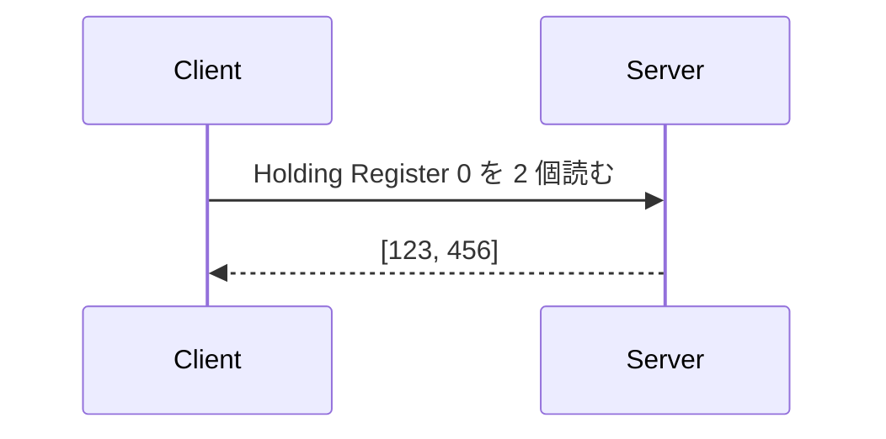

# AVModbus

AVModbus は、AtomVM で使うことを第一に設計した Modbus ライブラリです。

```text
AVModbus
  |
  +-- AtomVM 向けの Modbus ライブラリ
  +-- Modbus RTU / ASCII / TCP
  +-- Client / Server
```

ESP32 などの小さな機器から Holding Register を読んだり、機器側の Modbus Server を作ったりできます。
UART や RS485 を使う Modbus RTU / ASCII と、ネットワークを使う Modbus TCP に対応しています。

## はじめに知っておくこと

Modbus と RS485 は同じものではありません。

```text
Modbus
  └─ 何を送り、どう応答するかを決める通信ルール

RS485
  └─ データを電気信号としてどう運ぶかを決める方式
```

Modbus RTU は RS485 と組み合わせて使われることが多く、AVModbus では UART と
RS485 transceiver を介して通信します。

通信では、Client が要求を送り、Server が応答します。



初めて Modbus を使う場合は、先に [Modbus の基礎](docs/MODBUS_BASICS.md) を読むと、
Unit ID、Coil、Holding Register、Function Code などの用語を短時間で確認できます。

## 最短で試す

目的に合わせて次の順に進んでください。

1. [Modbus の基礎](docs/MODBUS_BASICS.md) — Modbus / RS485 とデータの種類を知る
2. [Getting Started](docs/GETTING_STARTED.md) — AVModbus を追加して最初の request を送る
3. [XIAO ESP32-C5 実機チュートリアル](examples/hello_atomvm_modbus/README.md) — 2 台の XIAO と HW-519 で通信する

## できること

- Modbus RTU / ASCII / TCP の Client と Server
- Coil、Discrete Input、Input Register、Holding Register の種類に応じた読み取り / 書き込み
- diagnostics、file record、FIFO、device identification などの標準 Function Code
- timeout、読み取り request の retry、UART / TCP の再接続
- supervision tree からの Client / Server 起動
- broadcast と RS485 adapter echo の処理
- `pymodbus` / `libmodbus` との相互運用テスト
- AtomVM + ESP32-C5 + RS485 での実機検証

対応範囲と実機で確認した内容は [ロードマップ](docs/ROADMAP.md) にまとめています。

## Client の最小例

UART の pin などを application configuration に設定してから Client を起動します。

```elixir
{:ok, client} = AVModbus.Client.start_link(mode: :rtu, timeout: 1_000)

{:ok, registers} =
  AVModbus.Client.read_holding_registers(client, 1, 0, 2)

IO.inspect(registers, label: "Holding Registers")
```

引数の `1` は Unit ID、`0` は先頭 address、`2` は読む register 数です。
成功すると `{:ok, [value1, value2]}`、時間内に応答がなければ `{:error, :timeout}` が返ります。

Modbus TCP の場合は UART の代わりに接続先を指定します。

```elixir
{:ok, client} =
  AVModbus.Client.start_link(
    tcp: "192.168.1.20",
    port: 502,
    timeout: 1_000
  )

AVModbus.Client.read_holding_registers(client, 1, 0, 2)
```

## Server の最小例

`AVModbus.Memory` を使うと、メモリ上に Coil や Register を持つ Server を作れます。

```elixir
{:ok, memory} = AVModbus.Memory.start_link()
:ok = AVModbus.Memory.put(memory, :holding_register, 0, [123, 456])

{:ok, server} =
  AVModbus.Server.start_link(
    handler: {AVModbus.Memory, memory},
    transport: :rtu,
    units: [1]
  )
```

実機での UART 設定、build、flash は
[XIAO ESP32-C5 実機チュートリアル](examples/hello_atomvm_modbus/README.md) を参照してください。

## ドキュメント

### 初めて使う人向け

- [Modbus の基礎](docs/MODBUS_BASICS.md)
- [Getting Started](docs/GETTING_STARTED.md)
- [XIAO ESP32-C5 実機チュートリアル](examples/hello_atomvm_modbus/README.md)

### 開発・設計に関わる人向け

- [開発者ガイド](docs/DEVELOPMENT.md) — 高度な Client 設定、テスト、相互運用性
- [アーキテクチャ](docs/ARCHITECTURE.md) — module の責務と設計
- [ロードマップ](docs/ROADMAP.md) — 完了条件、検証状況、platform constraint
- [Artifact size](docs/ARTIFACT_SIZE.md) / [Memory footprint](docs/MEMORY_FOOTPRINT.md)
- [ADR](https://github.com/mnishiguchi/avmodbus/tree/main/docs/adr) — 長期的に残す設計判断
- [Worklog](https://github.com/mnishiguchi/avmodbus/tree/main/docs/worklog) — 開発と実機検証の記録

## 開発

```sh
mise install
mix deps.get
mix format --check-formatted
mix test
```

property test、soak test、`pymodbus` / `libmodbus` との相互運用テストは
[開発者ガイド](docs/DEVELOPMENT.md) にまとめています。

## 対象 runtime

- AtomVM compatibility target: `release-0.7`
- 実機で使用した firmware: `v0.7.0-beta.0+git.8d3e051`
- AVModbus 自体の runtime dependency: なし

Modbus/TCP Security は、対象 AtomVM runtime に mutual TLS のための API が揃っていないため未対応です。
TLS option は安全のため `{:error, :tls_not_supported}` を返し、暗号化なしへ自動的に切り替わることはありません。

## ライセンス

Apache-2.0
