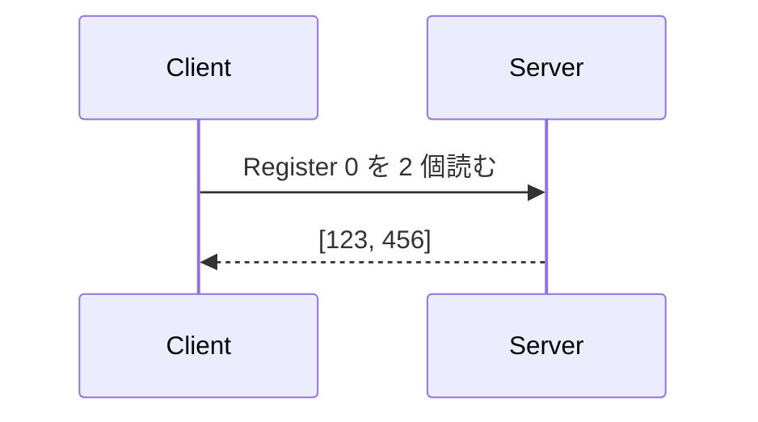
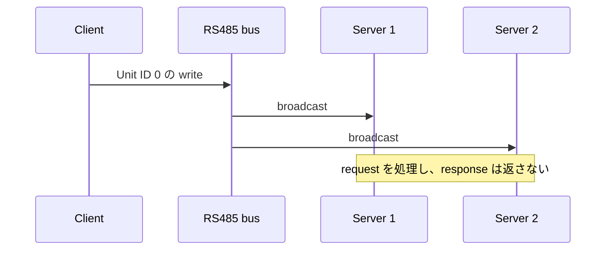

# Modbus の基礎

このページは、Modbus や RS485 を初めて使う人向けの用語集です。
AVModbus を動かす前に必要な範囲だけを説明します。

## Modbus とは

Modbus は、機器同士がデータを読み書きするための通信ルールです。
たとえば、温度を読む、設定値を書き換える、スイッチを ON にするといった操作を、共通の形式で表します。

Modbus 自体は「何を送るか」を定めます。ケーブルの電圧や信号の送り方は別の規格が担当します。

## Modbus と RS485 の違い

```text
Modbus = request / response とデータの意味を決める
RS485  = データを電気信号として運ぶ
```

Modbus RTU は RS485 と組み合わせることが多いですが、両者は別のものです。
ESP32 の UART signal を RS485 bus へ接続するには RS485 transceiver が必要です。

```text
ESP32-C5
    |
    | UART (TX / RX)
    v
RS485 transceiver
    |
    | RS485 (A / B)
    v
Modbus device
```

> **注意:**
> RS485 の `A` / `B` 表記は製品によって基準が異なることがあります。
> 通信できない場合も、電源を切ってから datasheet や端子表記を確認してください。

## Client と Server

Client は要求を送る側、Server は要求を受けて応答する側です。



古い資料では Client を Master、Server を Slave と表記している場合があります。
AVModbus の API とこのドキュメントでは Client / Server を使います。

## RTU / ASCII / TCP

| 方式 | 主な通信路 | frame の特徴 | error check |
| --- | --- | --- | --- |
| Modbus RTU | UART / RS485 | binary | CRC |
| Modbus ASCII | UART / RS485 | ASCII 文字列 | LRC |
| Modbus TCP | Ethernet / Wi-Fi | TCP 上の MBAP header + PDU | TCP に依存 |

- **RTU** は compact で、RS485 機器で広く使われます。
- **ASCII** は frame を文字で表し、frame の開始と終了が見分けやすい方式です。
- **TCP** は IP network 上で通信します。RS485 transceiver は使いません。

AVModbus は三つの方式すべてで Client / Server を利用できます。

## Unit ID

Unit ID は、どの Server 宛ての request かを示す番号です。
serial Modbus では Slave ID と呼ばれることもあります。

- 通常の範囲: `1..247`
- `0`: serial Modbus の broadcast
- Modbus TCP: gateway の先にある機器を識別するために使われることがあります

request で指定する Unit ID が Server の Unit ID と一致する必要があります。

## 四つのデータ領域

Modbus の基本データは四種類あります。

| データ | 大きさ | Client から見た操作 | 用途の例 |
| --- | ---: | --- | --- |
| Coil | 1 bit | 読み書き | 出力の ON / OFF |
| Discrete Input | 1 bit | 読み取り | スイッチやセンサー入力 |
| Input Register | 16 bit | 読み取り | 温度などの計測値 |
| Holding Register | 16 bit | 読み書き | 設定値や状態値 |

1 register は 16 bit です。32 bit 整数、float、文字列などを複数 register にどう並べるかは、
接続する機器の仕様書で確認します。byte order や word order は機器ごとに異なる場合があります。

### Address の注意

AVModbus API の address は `0` から始まります。
機器の説明書では最初の Holding Register を `40001` と書くことがありますが、API へ渡す値は
多くの場合 `0` です。説明書が `0` 始まりか `1` 始まりかを必ず確認してください。

## Function Code

Function Code は request の種類を表す番号です。

| Function Code | 操作 |
| --- | --- |
| `0x01` | Read Coils |
| `0x02` | Read Discrete Inputs |
| `0x03` | Read Holding Registers |
| `0x04` | Read Input Registers |
| `0x05` | Write Single Coil |
| `0x06` | Write Single Register |
| `0x0F` | Write Multiple Coils |
| `0x10` | Write Multiple Registers |
| `0x2B / 0x0E` | Read Device Identification |

AVModbus の helper function を使う場合、通常は Function Code を直接指定する必要はありません。

```elixir
AVModbus.Client.read_holding_registers(client, unit_id, address, quantity)
```

この関数は Function Code `0x03` の request を作成します。

## Request と Response

通常の通信は一つの request と一つの response で構成されます。

1. Client が Unit ID、Function Code、address などを送る
2. Server が request を処理する
3. Server が値、書き込み結果、または Modbus exception を返す

AVModbus は正常な読み取りを `{:ok, value}`、正常な書き込みを `:ok` で返します。

```elixir
{:ok, [123, 456]}
:ok
{:error, :timeout}
{:error, {:exception, :illegal_data_address}}
```

## CRC と LRC

- Modbus RTU は frame の末尾に **CRC** を付けます。
- Modbus ASCII は frame に **LRC** を付けます。

受信側は値を計算し直し、通信中にデータが壊れていないか確認します。
AVModbus が encode / decode 時に処理するため、application で計算する必要はありません。

## Broadcast

serial Modbus で Unit ID `0` へ送る write request は broadcast です。
bus 上の Server が request を処理しますが、response は返しません。



読み取りには使えません。応答がないため、書き込み結果を確認するには後から通常の read request を送ります。

## 次に読む

- [Getting Started](GETTING_STARTED.md)
- [XIAO ESP32-C5 実機チュートリアル](../examples/hello_atomvm_modbus/README.md)
- [AVModbus のアーキテクチャ](ARCHITECTURE.md)
