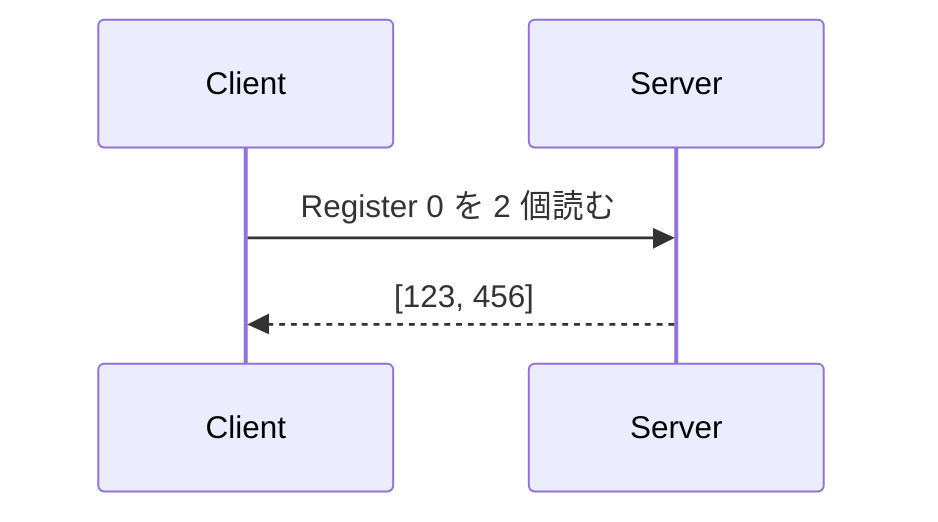
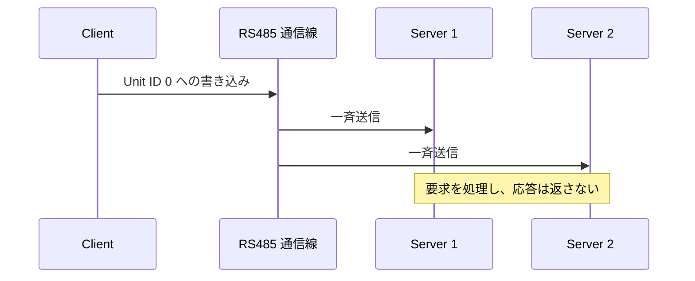

# Modbus の基礎

このページは、Modbus や RS485 を初めて使う人向けの用語集です。
AVModbus を動かす前に必要な範囲だけを説明します。

## Modbus とは

Modbus は、機器同士でデータを読み書きするための通信規格です。
たとえば、温度を読む、設定値を書き換える、スイッチを ON にするといった操作を、共通の形式で表します。

Modbus 自体は「何を送るか」を定めます。ケーブルの電圧や信号の送り方は別の規格が担当します。

## Modbus と RS485 の違い

```text
Modbus = 要求と応答の形式や、データの意味を決める
RS485  = データを電気信号として伝える
```

Modbus RTU は RS485 と組み合わせることが多いですが、両者は別のものです。
ESP32 の UART 信号を RS485 の通信線につなぐには、RS485 トランシーバーが必要です。

```text
ESP32-C5
    |
    | UART (TX / RX)
    v
RS485 トランシーバー
    |
    | RS485 (A / B)
    v
Modbus 対応機器
```

> **注意:**
> RS485 の `A` / `B` 表記は製品によって基準が異なることがあります。
> 通信できない場合は、電源を切ってからデータシートや端子の表記を確認してください。

## Client と Server

Client（クライアント）は要求を送る側、Server（サーバー）は要求を受けて応答する側です。



古い資料では Client を Master、Server を Slave と表記している場合があります。
AVModbus の API とこのドキュメントでは Client / Server を使います。

## RTU / ASCII / TCP

| 方式 | 主な通信路 | フレームの形式 | 誤り検出 |
| --- | --- | --- | --- |
| Modbus RTU | UART / RS485 | バイナリー | CRC |
| Modbus ASCII | UART / RS485 | ASCII 文字列 | LRC |
| Modbus TCP | Ethernet / Wi-Fi | MBAP ヘッダーと PDU | TCP の仕組みを利用 |

- **RTU** は通信データがコンパクトで、RS485 対応機器で広く使われます。
- **ASCII** はフレームを文字で表すため、通信データの始まりと終わりを見分けやすい方式です。
- **TCP** は IP ネットワーク上で通信します。通常、RS485 トランシーバーは必要ありません。

AVModbus は三つの方式すべてで Client / Server を利用できます。

## Unit ID

Unit ID は、要求の宛先となる Server を示す番号です。
シリアル通信の Modbus では、Slave ID と呼ばれることもあります。

- 通常の範囲: `1..247`
- `0`: シリアル通信の Modbus で使う一斉送信（ブロードキャスト）
- Modbus TCP: ゲートウェイの先にある機器を識別するために使われることがあります

通常の要求では、指定した Unit ID が通信先 Server の Unit ID と一致している必要があります。

## 四つのデータ領域

Modbus の基本データは四種類あります。

| データ | 大きさ | Client から見た操作 | 用途の例 |
| --- | ---: | --- | --- |
| Coil | 1 bit | 読み書き | 出力の ON / OFF |
| Discrete Input | 1 bit | 読み取り | スイッチやセンサー入力 |
| Input Register | 16 bit | 読み取り | 温度などの計測値 |
| Holding Register | 16 bit | 読み書き | 設定値や状態値 |

Register（レジスター）1 個は 16 bit です。32 bit 整数、小数、文字列などを複数のレジスターに
どう格納するかは機器によって異なります。バイト順やワード順も含めて仕様書を確認してください。

### アドレスの注意

AVModbus API のアドレスは `0` から始まります。
機器の説明書では最初の Holding Register を `40001` と書くことがありますが、API へ渡す値は
多くの場合 `0` です。説明書が `0` 始まりか `1` 始まりかを必ず確認してください。

## Function Code

Function Code（機能コード）は、読み取りや書き込みなど、要求の種類を表す番号です。

| Function Code | 操作 |
| --- | --- |
| `0x01` | Read Coils |
| `0x02` | Read Discrete Inputs |
| `0x03` | Read Holding Registers |
| `0x04` | Read Input Registers |
| `0x05` | Write Single Coil |
| `0x06` | Write Single Register |
| `0x0F` | Write Multiple Coils |
| `0x10` | Write Multiple Registers |
| `0x2B / 0x0E` | Read Device Identification |

AVModbus の補助関数を使えば、通常は Function Code を直接指定する必要はありません。

```elixir
AVModbus.Client.read_holding_registers(client, unit_id, address, quantity)
```

この関数は Function Code `0x03` の要求を作成します。

## 要求と応答

通常の通信では、要求（request）を一つ送り、応答（response）を一つ受け取ります。

1. Client が Unit ID、Function Code、アドレスなどを送る
2. Server が要求を処理する
3. Server が値、書き込み結果、または Modbus の例外応答を返す

AVModbus は正常な読み取りを `{:ok, value}`、正常な書き込みを `:ok` で返します。

```elixir
{:ok, [123, 456]}
:ok
{:error, :timeout}
{:error, {:exception, :illegal_data_address}}
```

## CRC と LRC

- Modbus RTU はフレームの末尾に **CRC** を付けます。
- Modbus ASCII はフレームに **LRC** を付けます。

受信側は値を計算し直し、通信中にデータが壊れていないか確認します。
AVModbus がエンコード・デコード時に処理するため、アプリケーション側で計算する必要はありません。

## ブロードキャスト（一斉送信）

シリアル通信の Modbus では、Unit ID `0` に書き込み要求を送ると、同じ通信線上の Server に一斉送信されます。
各 Server は要求を処理しますが、応答は返しません。



読み取りには使えません。書き込みを確認したい場合は、後から各 Server に通常の読み取り要求を送ります。

## 次に読む

- [はじめ方](getting-started.md)
- [XIAO ESP32-C5 実機チュートリアル](../examples/hello_atomvm_modbus/README.md)
- [アーキテクチャ](architecture.md)
